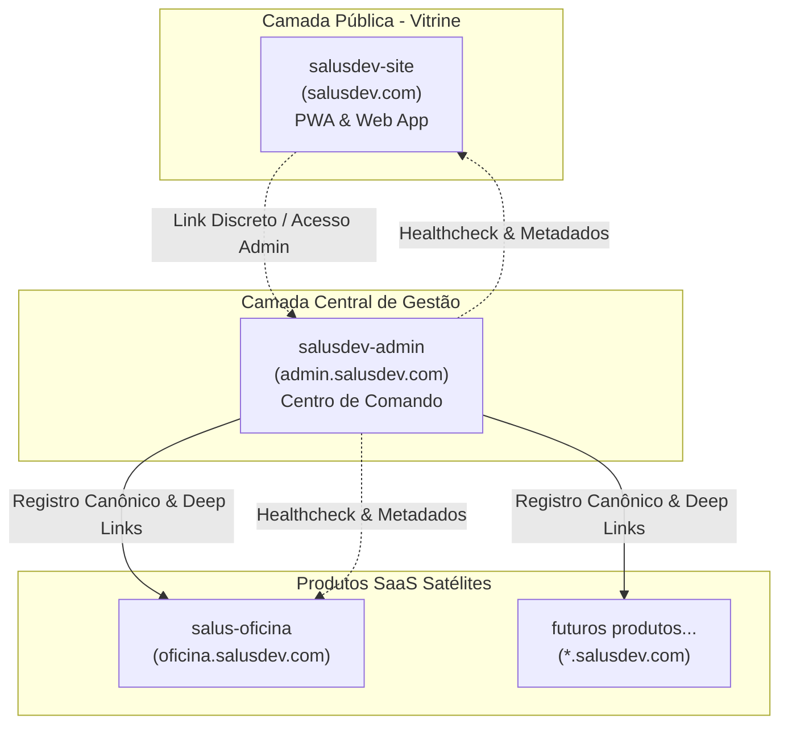
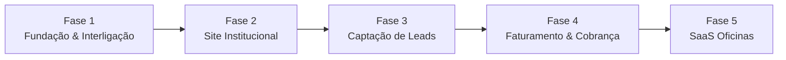

# PRD - Plataforma SalusDev

**Produto:** SalusDev.com & Ecossistema de Aplicações SalusDev (Web App & PWA)  
**Responsável pelo produto:** Rafael Amaral Salustiano  
**Versão:** 0.4  
**Status:** Refinado (Focado em Fundação de Interligação, PWA e Especificações [D] e [M])  
**Data:** 05/11/2026  

---

## 1. Visão geral

A SalusDev é uma empresa de tecnologia voltada ao desenvolvimento e comercialização de aplicações web modernas, sistemas SaaS, sites institucionais, e-commerce e soluções digitais sob medida para pequenos e médios negócios, com foco inicial em Apucarana e região.

O ecossistema é concebido como uma rede integrada de **Web Apps responsivos com suporte a PWA (Progressive Web App)**, acessíveis com alto desempenho tanto em dispositivos móveis quanto em desktop.

A estratégia de implantação foi estruturada em entregas planejadas:

1. **Fundação de Interligação de Sistemas:** Estruturação dos repositórios, topologia de subdomínios, catálogo canônico de produtos e contratos de dados compartilhados entre o Site Institucional (`salusdev-site`) e o Centro de Comando (`salusdev-admin`).
2. **Site Institucional da SalusDev (`salusdev-site`):** Presença digital pública, posicionamento de autoridade, apresentação de soluções e portfólio.
3. **Centro de Comando da SalusDev (`salusdev-admin`):** Aplicação administrativa privada para gestão centralizada de produtos, sistemas ativos, clientes e governança do ecossistema.
4. **Captação de Leads e Faturamento:** Fluxos transacionais de formulários de leads, notificações e régua de cobrança/assinaturas via Mercado Pago, implementados sequencialmente após a validação da base estrutural.
5. **Produtos SaaS Satélites:** Aplicações especializadas (ex.: SaaS para Oficinas Mecânicas), conectadas ao Centro de Comando para controle de acesso e assinaturas, mas com bancos operacionais totalmente isolados.

---

## 2. Objetivos do produto

### 2.1 Objetivo principal

Criar a fundação técnica, a presença digital pública e a estrutura operacional centralizada da SalusDev como um ecossistema de Web Apps e PWAs, permitindo posicionar a marca profissionalmente, navegar fluidamente entre desktop e celular, e administrar os produtos e clientes em um ambiente unificado e seguro.

### 2.2 Objetivos específicos

- Estabelecer a arquitetura de interligação de sistemas antes da construção de regras transacionais complexas.
- Garantir suporte a PWA (Progressive Web App) para instalação em dispositivos móveis e atalho em desktops.
- Tratar o desenvolvimento com especificações e testes divididos obrigatoriamente entre **Desktop `[D]`** e **Mobile `[M]`**.
- Posicionar a SalusDev como fornecedora regional de referência em soluções digitais sob medida.
- Apresentar serviços e produtos sem publicar tabela fixa de preços no site.
- Viabilizar contato direto inicial via WhatsApp oficial.
- Centralizar o catálogo de produtos e sistemas no Centro de Comando.
- Isolar os bancos de dados operacionais de futuros produtos SaaS para garantir segurança e conformidade LGPD.
- Postergardos para fases subsequentes: automação de leads e integração com gateway de pagamento (Mercado Pago).

---

## 3. Público-alvo inicial

### 3.1 Público primário (Clientes do Site)

- Pequenas e médias empresas de Apucarana e região.
- Negócios locais que ainda operam com processos manuais ou planilhas desorganizadas.
- Empresas que buscam presença digital profissional e adaptada ao celular.
- Profissionais que necessitam de aplicações sob medida para seu segmento.

### 3.2 Usuário do Centro de Comando

- Rafael Amaral Salustiano (Administrador único na fase inicial).

### 3.3 Expansão futura

- Atendimento a clientes de outras regiões do Paraná e, posteriormente, nível nacional.

---

## 4. Proposta de valor

A SalusDev oferece a combinação entre presença digital de alto impacto e aplicações web de gestão robustas e acessíveis de qualquer lugar (desktop ou celular via PWA).

Pilares da comunicação de valor:
- Atendimento próximo e personalizado.
- Aplicações Web e PWA rápidas, seguras e responsivas.
- Digitalização de rotinas sem complexidade desnecessária.
- Sistemas modulares com capacidade de expansão contínua.
- Governança rigorosa de dados e segurança desde a concepção.

---

## 5. Arquitetura de Interligação de Sistemas e Topologia do Ecossistema

Esta seção estabelece a espinha dorsal de comunicação, roteamento e isolamento entre as aplicações da SalusDev.



### 5.1 Topologia de domínios e DNS

- **Domínio Raiz Público:** `https://salusdev.com` (e `www.salusdev.com`) → Aplicação pública do Site Institucional.
- **Subdomínio de Gestão Privada:** `https://admin.salusdev.com` → Centro de Comando da SalusDev.
- **Subdomínios de Aplicações Satélites:** `https://[produto].salusdev.com` (ex.: `https://oficina.salusdev.com`).
- **Padrão de Ambientes:**
  - Produção: `salusdev.com` / `admin.salusdev.com`
  - Homologação / Staging: `staging.salusdev.com` / `admin-staging.salusdev.com`

### 5.2 Mapeamento de repositórios GitHub

Cada aplicação do ecossistema possui seu próprio ciclo de versionamento e deploy:

| Aplicação | Repositório Oficial | Finalidade | Deploy |
|---|---|---|---|
| Site Institucional | `https://github.com/RafSalus/salusdev-site` | Presença institucional, vitrine e contato público | Netlify |
| Centro de Comando | `salusdev-admin` (Protótipo em `salusdev-prototypes`) | Hub administrativo, catálogo de produtos e controle | Netlify |
| SaaS Oficinas (Futuro) | `salus-oficina` | Sistema operacional multi-tenant para oficinas | Netlify / Dedicated |

### 5.3 Contrato canônico de aplicações (Catálogo Central)

O Centro de Comando atua como o registro oficial de governança de todas as aplicações da SalusDev. Cada sistema registrado deve implementar o seguinte contrato:

```typescript
export type ProductStatus = "Planejamento" | "Desenvolvimento" | "Piloto" | "Ativo" | "Descontinuado"

export interface SystemContract {
  id: string              // ex: "salusdev-site", "salus-oficina"
  name: string            // ex: "SalusDev Institucional", "Salus Oficina"
  short: string           // ex: "SD", "SO"
  category: string        // ex: "Site institucional", "SaaS para oficinas"
  status: ProductStatus   // ciclo de vida do sistema
  description: string     // resumo executivo
  clients: number         // total de clientes vinculados
  updated: string         // última atualização
  progress: number        // progresso da versão atual (0-100%)
  color: string           // cor tema para identificação visual
  appUrl?: string         // URL pública em produção
  stagingUrl?: string     // URL de homologação
  repoUrl?: string        // Link do repositório GitHub
  healthCheckUrl?: string // Rota de verificação de disponibilidade
  version: string         // ex: "v1.0.0"
}
```

### 5.4 Endpoints de Healthcheck e monitoramento

Toda aplicação conectada ao ecossistema deve expor um endpoint estático ou de API leve (ex.: `/api/health` ou `/health.json`), retornando:

```json
{
  "system": "salusdev-site",
  "status": "healthy",
  "version": "1.0.0",
  "timestamp": "2026-11-05T16:00:00Z"
}
```

O Centro de Comando utilizará esse contrato para verificar o status operacional dos sistemas cadastrados.

### 5.5 Diretrizes de fronteira e isolamento de dados

Para proteger a integridade técnica e cumprir os requisitos de segurança e LGPD:

1. **Centralizado no Centro de Comando:**
   - Catálogo de produtos, links e versões.
   - Cadastro corporativo dos clientes (dados cadastrais gerais).
   - Quais produtos cada cliente tem direito a utilizar.
   - Auditoria interna de ações administrativas.
2. **Estritamente Isolado em Cada Produto Satélite:**
   - Dados transacionais operacionais (ex.: clientes de oficinas, veículos, ordens de serviço, notas e dados de terceiros pertencem exclusivamente ao banco daquele produto).
   - O banco do Centro de Comando não recebe nem armazena dados operacionais dos produtos satélites.

### 5.6 Navegação cruzada (Cross-Navigation)

- **Site → Centro de Comando:** Link de acesso administrativo discreto no rodapé (`admin.salusdev.com`) para Rafael.
- **Centro de Comando → Produtos:** O painel disponibiliza links diretos de navegação e atalhos rápidos para abrir as versões em produção e repositórios dos produtos cadastrados.

---

## 6. Natureza Web App, Suporte a PWA e Convenção Desktop [D] e Mobile [M]

### 6.1 Web App e PWA (Progressive Web App)

Tanto o Site Institucional quanto o Centro de Comando e futuros SaaS são desenvolvidos como Web Apps modernos com arquitetura compatível com PWA.

Requisitos de PWA:
- **Manifesto Web (`manifest.json`):** Configurado com nome da aplicação, cores temáticas (`theme_color: #173e32`, `background_color: #f5f6f2`), display `standalone` e conjunto de ícones em alta resolução (192x192, 512x512, maskable).
- **Service Worker:** Implementação com cache de ativos estáticos (HTML, JS, CSS, fontes e ícones) para carregamento instantâneo em conexões instáveis.
- **Instalação (A2HS - Add to Home Screen):** Capacidade de instalação como app no Android, iOS (via Safari "Adicionar à Tela de Início") e atalho no Google Chrome/Edge em desktop.

### 6.2 Convenção de desenvolvimento e testes: Desktop [D] e Mobile [M]

Todas as especificações de tela, componentes, critérios de aceite e revisões de qualidade devem adotar explicitamente a marcação **`[D]`** e **`[M]`**:

| Dispositivo | Sigla | Resoluções de Teste | Foco de Experiência e Layout |
|---|---|---|---|
| **Desktop** | `[D]` | `1024 px` e `1440 px` | Barra lateral (Sidebar) fixa expandida, navegação analítica, tabelas com colunas completas, filtros simultâneos visíveis, suporte amplo a teclado/mouse, densidade de informações equilibrada. |
| **Mobile** | `[M]` | `360 px` e `768 px` | Menu gaveta (drawer) retrátil com acionamento por botão hamburguer, modais em tela cheia ou bottom sheets, navegação por toque (touch targets >= 44 px), tabelas transformadas em cards verticais. |

---

## 7. Escopo detalhado e priorização MoSCoW

O escopo foi dividido em fases para garantir que a fundação de interligação e presença esteja concluída antes da implementação de fluxos transacionais.

```text
MoSCoW da Fase 1 (Fundação e Vitrine):
├── MUST HAVE:
│   ├── [D] e [M] Site Institucional com páginas Início, Soluções, Produtos, Sobre, Contato
│   ├── [D] e [M] Centro de Comando com Catálogo de Produtos e Indicadores do Ecossistema
│   ├── [D] e [M] Botão flutuante e de seção para WhatsApp oficial
│   ├── [D] e [M] Suporte a PWA (manifest.json e ícones)
│   └── Interligação de subdomínios e links cruzados
├── SHOULD HAVE:
│   ├── [D] e [M] Modo offline básico de leitura no PWA
│   └── Formulário de contato simplificado com validação local
└── WON'T HAVE (Adiados para Fases 3 e 4):
    ├── Automação de envio e processamento de leads no Supabase (Fase 3)
    ├── E-mails transacionais automáticos (Fase 3)
    ├── Integração com Mercado Pago e webhooks (Fase 4)
    ├── Módulo de contratos, assinaturas e cobrança recorrente (Fase 4)
    └── Módulo de atendimentos ao cliente (Fase 4)
```

### 7.1 Fase 1 - Entrega Pública: Site Institucional (`salusdev-site`)

#### Páginas previstas

1. **Início:** Hero com proposta de valor, apresentação dos pilares da SalusDev, destaques de soluções e atalho para WhatsApp.
2. **Soluções:** Apresentação clara das categorias de desenvolvimento (Web Apps, SaaS, Sites, Personalizados).
3. **Produtos:** Vitrine dos sistemas SalusDev (ativos e em desenvolvimento, como o SaaS de Oficinas).
4. **Sobre a SalusDev:** Posicionamento institucional, propósito regional e tecnologia aplicada.
5. **Contato:** Telefone, WhatsApp oficial, links institucionais e localização em Apucarana-PR.
6. **Política de Privacidade e Termos de Uso:** Páginas legais estruturadas.
7. **Página 404:** Layout amigável com redirecionamento para o Início.

#### Especificações [D] e [M] do Site

- **`[D]`:** Header fixo no topo com navegação horizontal, layout em grade com cartões informativos, chamadas visuais e atalho de acesso discreto ao Admin no rodapé.
- **`[M]`:** Header com menu recolhível hamburguer, botão de contato WhatsApp em barra inferior ou botão flutuante com fácil alcance do polegar.

### 7.2 Fase 1 - Gestão Centralizada: Centro de Comando (`salusdev-admin`)

#### Módulo de Produtos (Ativo e Prioritário)

- Visualização do catálogo de produtos e sistemas SalusDev.
- Métricas consolidadas: Total de produtos, Em desenvolvimento, Ativos, Clientes vinculados.
- Filtro por situação: `Todos`, `Planejamento`, `Desenvolvimento`, `Piloto`, `Ativo`, `Descontinuado`.
- Busca rápida por nome e categoria.
- Modal para cadastro e edição de produtos (fictícios/mocks no protótipo).
- Links para repositório e aplicação em produção.
- Visualização detalhada de dados do produto.

#### Especificações [D] e [M] do Centro de Comando

- **`[D]`:** Barra lateral esquerda fixa (252 px) com logotipo, navegação por grupos (*Visão geral* e *Gestão*) e status de protótipo no topo.
- **`[M]`:** Barra lateral recolhível via drawer animado, botão de menu no topo esquerdo, cards de produtos empilhados verticalmente com botões de ação com toque confortável.

---

## 8. Canais de comunicação e contato

### 8.1 Canal imediato: WhatsApp oficial

- O WhatsApp será o canal comercial e de atendimento prioritário na Fase 1.
- Links direcionarão para o número oficial com mensagem pré-formatada:
  `Olá! Acessei o site da SalusDev e gostaria de entender como desenvolver uma solução para minha empresa.`
- Implementação sem dependência de APIs complexas no lançamento inicial.

### 8.2 Formulário de contato e captação de Leads (Fase 3)

- Na Fase 3 será introduzido o formulário de captação formal com campos: nome, empresa, WhatsApp, e-mail, tipo de projeto, mensagem e aceite de privacidade.
- Salvamento no Supabase e disparo de notificações por e-mail ficarão estritamente concentrados na Fase 3 do roadmap.

---

## 9. Integração com Mercado Pago (Fase 4 - Cobrança e Faturamento)

A integração financeira será implementada na **Fase 4**, após a validação do site e do Centro de Comando:

- Cobranças avulsas (serviços de desenvolvimento).
- Cobranças recorrentes (assinaturas dos produtos SaaS).
- Processamento seguro via webhooks validados com idempotência e auditoria.
- Suspensão e reativação manuais pelo administrador.
- Nenhuma credencial ou dado sensível exposto no frontend.

---

## 10. Identidade visual e Design Tokens

A identidade visual adotada une sobriedade, tecnologia e sustentabilidade:

- **Verde Institucional Principal:** `#173e32` (profundidade, tecnologia e confiabilidade).
- **Verde Destaque:** `#31866b` e `#3c846b` (ação, botões e elementos interativos).
- **Fundos e Superfícies:** `#f5f6f2` (fundo suave) e `#ffffff` (cartões e modais).
- **Textos:** `#18342a` (títulos principais) e `#75837d` (textos de apoio).
- **Tipografia:** Fonte sem serifa moderna, legível e otimizada para telas digitais.
- **Regra de Redação:** Não utilizar o caractere `&` em textos visíveis; utilizar `e`.

---

## 11. Requisitos de experiência e interface (UI/UX) [D] e [M]

### 11.1 Requisitos Desktop [D]

- Resoluções de teste: 1024 px e 1440 px.
- Aproveitamento inteligente de tela ampla sem esticar elementos desproporcionalmente (max-width de 1400 px no conteúdo).
- Estados visuais completos em hover, active e focus em botões e links.
- Navegação fluida sem recarregamento de página (SPA).

### 11.2 Requisitos Mobile [M]

- Resoluções de teste: 360 px e 768 px.
- Alvos de toque com área mínima de 44x44 px.
- Nenhuma barra de rolagem horizontal involuntária.
- Modais e formulários com visualização limpa acima do teclado virtual.
- Menus e filtros acessíveis com apenas um toque.

### 11.3 Acessibilidade mínima (WCAG 2.2 AA essencial)

- Contraste mínimo de 4.5:1 para textos normais.
- Indicador visível de foco para navegação por teclado.
- Rótulos explícitos em campos e botões.
- Textos alternativos (`alt`) em imagens institucionais.
- Informações não dependentes exclusivamente de cor.

---

## 12. Requisitos técnicos e Stack

- **Linguagem:** TypeScript (tipagem estrita).
- **Biblioteca de UI:** React 19.
- **Bundler e Dev Server:** Vite 8.
- **Estilização:** Tailwind CSS v4.
- **PWA:** Vite PWA Plugin ou service worker nativo com `manifest.json`.
- **Hospedagem:** Netlify (com suporte a SPA redirects e cabeçalhos de segurança).
- **Controle de Versão:** Git e GitHub.
- **Banco de Dados (Fases Futuras):** Supabase (PostgreSQL com RLS e Auth).
- **Gateway de Pagamento (Fases Futuras):** Mercado Pago API v1/v2.

---

## 13. Segurança e isolamento como requisitos prioritários

1. **Defesa em Profundidade:**
   - HTTPS forçado em todas as rotas e subdomínios.
   - Cabeçalhos de proteção (HSTS, CSP, X-Frame-Options, X-Content-Type-Options).
   - Nenhuma chave de API ou segredo em repositório público ou código cliente.
2. **Isolamento entre Produtos:**
   - Cada sistema SaaS satélite operará com base de dados segregada.
   - Não há compartilhamento de dados operacionais de clientes entre produtos.
3. **Administração Segura:**
   - Centro de Comando restrito a Rafael.
   - Variáveis de ambiente gerenciadas via Netlify Console.

---

## 14. Modelo conceitual de dados

A espinha dorsal de entidades da plataforma:

```text
Produto / Sistema (Catálogo Central do Ecossistema)
├── Clientes (Dados Cadastrais)
│   └── Contratos (Condições Comerciais - Fase 4)
│       └── Assinaturas (Recorrência - Fase 4)
│           └── Pagamentos (Conciliação - Fase 4)
└── Healthcheck / Status Operacional
```

---

## 15. LGPD, privacidade e conformidade legal

- Política de Privacidade e Termos de Uso redigidos de forma clara e acessível no site.
- Coleta de dados limitada estritamente ao necessário para atendimento comercial.
- Nenhum cookie invasivo ou rastreamento de terceiros sem aviso e consentimento.
- Canal de atendimento direto ao titular para pedidos de exclusão ou alteração de dados.

---

## 16. Requisitos de qualidade

Antes de cada entrega de versão:
- `[D]` Interface validada visualmente em 1024 px e 1440 px.
- `[M]` Interface validada visualmente em 360 px e 768 px.
- PWA validado quanto à presença de manifesto, ícones e instalação.
- Ausência total de erros no console do navegador e no build (`npm run build`).
- TypeScript compilando sem avisos ou `any` desnecessários.
- Links e botões testados com ações correspondentes.

---

## 17. Fora do escopo inicial (Fase 1)

Os seguintes itens estão explicitamente **fora do escopo da Fase 1**:
- Formulário de captação automática de leads integrado a banco de dados (Fase 3).
- Notificações automáticas por e-mail transacional (Fase 3).
- Cobranças, assinaturas e integração com Mercado Pago (Fase 4).
- Autenticação com múltiplos níveis de permissão no Centro de Comando.
- Banco de dados de produção ativo no protótipo.
- Desenvolvimento das regras operacionais do SaaS de oficinas (Fase 5).

---

## 18. Estratégia de prototipação

As interfaces continuam sendo prototipadas e validadas no repositório `salusdev-prototypes` antes de serem promovidas para o código de produção definitivo em `salusdev-site` e `salusdev-admin`.

Regras de Prototipação:
- Dados estritamente fictícios para visualização.
- Agilidade de exploração visual.
- Mensagem visual explícita indicando *"Ambiente de protótipo"*.
- Validação rápida de decisões com Rafael.

---

## 19. Roadmap reestruturado em 5 fases



### Fase 1 - Fundação de Interligação de Sistemas e Catálogo Central (Em andamento)
- [x] Criação do repositório público do site: `https://github.com/RafSalus/salusdev-site`.
- [x] Prototipação da tela de Produtos no Centro de Comando (`src/App.tsx`).
- [x] Definição da topologia de subdomínios (`salusdev.com`, `admin.salusdev.com`).
- [x] Definição de Web App com suporte a PWA e padrão Desktop `[D]` e Mobile `[M]`.
- [x] Atualização do PRD para v0.4 formalizando a interligação de sistemas.

### Fase 2 - Site Institucional e Vitrine Digital
- [ ] Configuração do projeto `salusdev-site` com React 19, Vite, Tailwind CSS v4 e PWA.
- [ ] Implementação das páginas Início, Soluções, Produtos, Sobre, Contato `[D]` e `[M]`.
- [ ] Botão e links de contato direto com WhatsApp oficial.
- [ ] Páginas de Política de Privacidade e Termos de Uso.
- [ ] Deploy e publicação em produção no Netlify (`salusdev.com`).

### Fase 3 - Captação de Leads e Funil Comercial
- [ ] Configuração do Supabase para registro de leads.
- [ ] Formulário de orçamento no site com proteção anti-spam e validação de campos.
- [ ] Envio de e-mail transacional para o administrador.
- [ ] Módulo de Leads no Centro de Comando para acompanhamento e conversão.

### Fase 4 - Cobrança e Faturamento Recorrente
- [ ] Integração com gateway Mercado Pago (API de pagamentos e assinaturas).
- [ ] Processamento de webhooks com verificação de segurança e idempotência.
- [ ] Módulos de Contratos, Assinaturas e Pagamentos no Centro de Comando.
- [ ] Conciliação e controle de inadimplência manual.

### Fase 5 - Primeiro Produto Satélite (SaaS para Oficinas)
- [ ] Elaboração do PRD específico de `salus-oficina`.
- [ ] Criação do repositório dedicado e banco isolado multi-tenant.
- [ ] Conexão do produto ao Centro de Comando via catálogo de produtos e assinaturas.
- [ ] Validação do cliente piloto.

---

## 20. Critérios de aceite do lançamento da Fase 1

### [D] Desktop
- [ ] Navegação completa entre telas sem quebras visuais em 1024 px e 1440 px.
- [ ] Catálogo de produtos no Centro de Comando exibindo dados fictícios coerentes com os sistemas SalusDev.
- [ ] Filtro por status e barra de pesquisa funcionando fluidamente.
- [ ] Modal de criação/edição permitindo cadastrar e atualizar produtos fictícios com feedback por toast.

### [M] Mobile
- [ ] Menu gaveta responsivo funcionando sem travamento em 360 px e 768 px.
- [ ] Layout adaptado sem overflow horizontal.
- [ ] Cards de produtos com tipografia legível e alvos de toque adequados.

### PWA
- [ ] Arquivo `manifest.json` válido com ícones e display standalone.
- [ ] Capacidade de instalação e carregamento rápido de recursos estáticos.

---

## 21. Riscos principais

| Risco | Impacto | Mitigação |
|---|---|---|
| Acoplamento excessivo entre sistemas | Alto | Contratos canônicos de produto e isolamento estrito de bancos de dados. |
| Perda de foco em fluxos transacionais precoces | Médio | Faseamento claro: leads e pagamentos postergados para as Fases 3 e 4. |
| Inconsistência de experiência entre dispositivos | Alto | Padrão obrigatório de desenvolvimento e testes separados em Desktop [D] e Mobile [M]. |
| Falta de instalação do app em mobile | Médio | Configuração de PWA nativa com manifesto web e ícones adaptativos. |

---

## 22. Decisões registradas

1. O projeto SalusDev será desenvolvido como um ecossistema integrado de Web Apps com suporte a PWA.
2. O desenvolvimento e especificações serão obrigatoriamente divididos em Desktop `[D]` e Mobile `[M]`.
3. A prioridade imediata é a fundação de interligação de sistemas e a vitrine pública, postergando formulários complexos de leads e integrações financeiras com Mercado Pago para fases posteriores.
4. O repositório público do site já está registrado em `https://github.com/RafSalus/salusdev-site`.
5. O Centro de Comando (`admin.salusdev.com`) atuará como o hub central de governança e catálogo de produtos do ecossistema.
6. Os bancos de dados operacionais dos futuros SaaS satélites serão isolados do banco do Centro de Comando.
7. O WhatsApp direto será o canal de contato e conversão primário na primeira entrega pública.
8. A identidade visual adotará tons de verde profundo (`#173e32`) com suporte a visual limpo e profissional.
9. O repositório `salusdev-prototypes` continuará sendo utilizado para exploração visual e demonstrações comerciais antes da implementação definitiva.

---

## 23. Questões em aberto (Refinadas para o MVP)

- Definição do número de WhatsApp oficial da SalusDev.
- Escolha da biblioteca/estratégia PWA definitiva no Vite (`vite-plugin-pwa` vs. service worker customizado).
- Registro final do domínio `salusdev.com` e apontamento de DNS no Netlify.

---

## 24. Histórico de versões e aprovação

| Versão | Data | Alteração | Agente |
|---|---|---|---|
| 0.3 | 2026-11-04 | Rascunho inicial do produto | Rafael Amaral Salustiano |
| 0.4 | 2026-11-05 | Reestruturação completa: inclusão da Seção de Interligação de Sistemas (topologia, catálogo central e repositório `salusdev-site`), natureza Web App & PWA, padronização Desktop [D] e Mobile [M], e reordenação do Roadmap em 5 fases com adiamento de leads e pagamentos | @pm (Morgan) & @architect (Aria) |

### Aprovação do Documento

| Responsável | Papel | Status | Data |
|---|---|---|---|
| Rafael Amaral Salustiano | Fundador e Líder de Produto | Em validação | 05/11/2026 |
