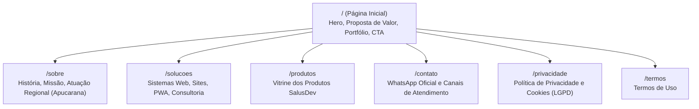
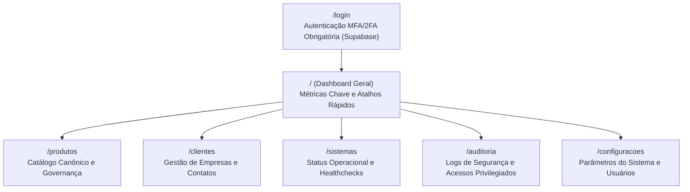

# Sitemap e Guia de Conteúdo Institucional - Ecossistema SalusDev

- **Documento:** Mapa de Estrutura e Conteúdo das Aplicações SalusDev
- **Versão:** 1.0
- **Data:** 2026-11-06
- **Agente:** `@pm` (Morgan)
- **Status:** Homologado
- **Referência:** [PRD-SalusDev-v0.3.md](file:///D:/SalusDev%20-%20Admin/doc/produto/PRD-SalusDev-v0.3.md) (v0.4) e [RegrasSystema.md](file:///D:/SalusDev%20-%20Admin/doc/produto/RegrasSystema.md)

---

## 1. Visão Geral da Arquitetura de Informação

O ecossistema SalusDev é estruturado em duas superfícies principais independentes, ambas projetadas como Web Apps com suporte completo a PWA, com distinção obrigatória entre a experiência Desktop `[D]` e Mobile `[M]`:

1. **Site Institucional (`salusdev-site`):** Superfície pública, vitrine de autoridade e canal de captação institucional.
2. **Centro de Comando (`salusdev-admin`):** Superfície de gestão privada, hub de governança de catálogo de produtos, clientes e operações do ecossistema.

---

## 2. Sitemap do Site Institucional (`salusdev-site` - `https://salusdev.com`)

### 2.1 Detalhamento de Seções e Conteúdo (`salusdev-site`)

| Rota | Objetivo | Conteúdo Principal | Visão Desktop `[D]` | Visão Mobile `[M]` |
|---|---|---|---|---|
| `/` | Conversão e apresentação de autoridade | Hero impactante, pilares de valor, soluções em destaque, depoimentos e CTA | Header completo com menu horizontal e botão de ação | Header compacto com menu gaveta (drawer), alvos de toque >= 44 px |
| `/sobre` | Humanização e posicionamento regional | Trajetória de Rafael Amaral Salustiano, foco em Apucarana e região, metodologia ágil e compromisso de segurança | Grid bi-colunar com foto, timeline e marcos da empresa | Fluxo vertical empilhado com cartões de leitura rápida |
| `/solucoes` | Explicar os serviços sob medida | Criação de Web Apps, modernização de rotinas, integração de APIs e consultoria técnica | Grid de 3 colunas com cards expansíveis e ícones | Lista de acordeons ou cards verticais com navegação por deslize |
| `/produtos` | Vitrine dos produtos do ecossistema | Apresentação do Salus Oficina e soluções prontas, sem expor tabela de preços fixa pública | Grid de cartões de produtos com tags de status e botão para demonstração | Cartões com largura total (1 coluna), botão de ação fixo na rolagem |
| `/contato` | Canal de atendimento direto | Chamada direta para WhatsApp Oficial, e-mail institucional e localização em Apucarana | Box em destaque com QR Code e botão de clique direto | Botão flutuante de WhatsApp e clique para chamada imediata |
| `/privacidade` | Conformidade LGPD | Declaração de privacidade, encarregado (DPO), direitos do titular e política de cookies | Menu lateral de navegação rápida por tópicos | Sumário inicial retrátil e leitura contínua com tipografia legível |

---

## 3. Sitemap do Centro de Comando (`salusdev-admin` - `https://admin.salusdev.com`)

### 3.1 Detalhamento de Módulos Administrativos (`salusdev-admin`)

| Rota | Objetivo | Conteúdo Principal | Visão Desktop `[D]` | Visão Mobile `[M]` |
|---|---|---|---|---|
| `/login` | Acesso seguro e controlado | Formulário de credenciais seguido obrigatoriamente de desafio MFA via TOTP | Card centralizado com feedback de segurança | Card ocupando a largura da tela com teclado numérico acionado no OTP |
| `/` | Visão executiva | Total de produtos ativos, clientes atendidos, status dos serviços e atalhos rápidos | Grade analítica 4x2 com gráficos de densidade executiva | Cartões empilhados com métricas resumidas e navegação rápida |
| `/produtos` | Gestão do catálogo canônico | Listagem, filtros por status, cadastro e edição de produtos do ecossistema | Barra lateral persistente, tabela rica com filtros avançados e drawer de detalhes | Barra superior com busca, lista em cards compactos e modal fullscreen |
| `/clientes` | Cadastro de clientes | Empresas atendidas, contatos, produtos contratados e estágio de relacionamento | Tabela com ordenação, paginação e ações rápidas em linha | Cards expansíveis com botão de ação direta para WhatsApp do cliente |
| `/sistemas` | Monitoramento e links | Lista de subdomínios, deep links de acesso e status de healthcheck | Indicadores visuais de status (Verde/Amarelo/Vermelho) em grade | Lista resumida com status operacional e botão de teste |
| `/auditoria` | Rastreabilidade e conformidade | Registro de logins, falhas de autenticação, ativação de MFA e alterações sensíveis | Tabela com busca por IP, data e usuário, exportação em CSV | Filtro simplificado por data e visualização dos últimos 20 eventos |

---

## 4. Diretrizes de Conteúdo e Tom de Voz

1. **Clareza e Pragmatismo:** Linguagem direta, sem jargões corporativos vazios. O cliente deve entender imediatamente como o produto resolve seu gargalo operacional.
2. **Regionalismo e Proximidade:** Destaque para a presença em Apucarana e atendimento humano direto por Rafael Amaral Salustiano.
3. **Segurança e Confiança:** Enfatizar que os sistemas são concebidos com padrões profissionais de privacidade (LGPD), proteção de dados e autenticação robusta.
4. **Sem Preços Públicos Fixos:** O modelo de precificação é sob medida ou por assinatura mediante diagnóstico. O CTA prioritário direciona para conversa diagnóstica.
5. **Idioma Canônico:** Português do Brasil com acentuação rigorosa, sem o uso do caractere `&` em texto visível.
