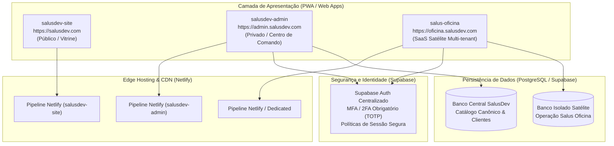
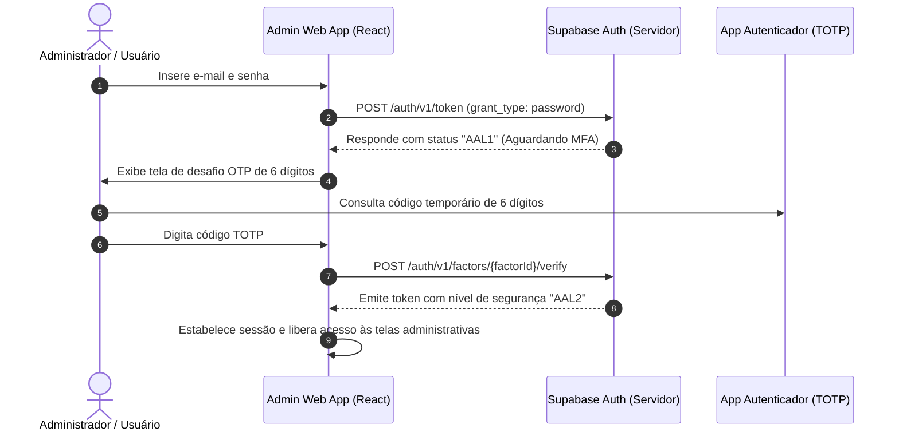

# Arquitetura do Sistema - Ecossistema SalusDev

- **Documento:** Especificação Técnica de Arquitetura e Engenharia de Software
- **Versão:** 1.0
- **Data:** 2026-11-06
- **Agente:** `@architect` (Aria)
- **Status:** Homologado
- **Referências:** [PRD-SalusDev-v0.3.md](file:///D:/SalusDev%20-%20Admin/doc/produto/PRD-SalusDev-v0.3.md) (v0.4), [RegrasSystema.md](file:///D:/SalusDev%20-%20Admin/doc/produto/RegrasSystema.md) (v1.4) e [RegrasDesenvolvimento.md](file:///D:/SalusDev%20-%20Admin/doc/produto/RegrasDesenvolvimento.md)

---

## 1. Visão Geral da Arquitetura

O ecossistema SalusDev é projetado sob o modelo de **Sistemas Federados e Desacoplados (Federated Multi-Repo Architecture)**, unindo a velocidade e independência de deploy de cada aplicação à integridade de governança corporativa centralizada.

Toda aplicação do ecossistema é concebida como **Web App responsivo com capacidade PWA (Progressive Web App)**, projetada nativamente para atender às especificações distintas de Desktop `[D]` e Mobile `[M]`.



---

## 2. Princípios Arquiteturais Fundamentais

1. **Defesa em Profundidade e Redução de Raio de Explosão (*Blast Radius*):** Um comprometimento, falha de deploy ou instabilidade no Site Institucional não pode paralisar o Centro de Comando ou os sistemas operacionais dos clientes.
2. **Negação por Padrão e Autenticação de Múltiplos Fatores:** Acesso restrito a usuários identificados com verificação de credencial e segundo fator (MFA / 2FA via TOTP).
3. **Isolamento Estrito de Dados:** Bancos de dados de clientes SaaS operam em instâncias e esquemas isolados do banco corporativo da SalusDev.
4. **Resiliência e Desacoplamento:** Nenhuma tela depende de chamadas síncronas bloqueantes entre aplicações distintas na camada de renderização.
5. **Padrão Dual de Experiência `[D]` e `[M]`:** Cada módulo deve ser projetado considerando o comportamento específico do desktop com mouse/teclado e do mobile com toque e gavetas retráteis.

---

## 3. Topologia Multi-Repo e Ciclo de Vida de Software

Cada aplicação opera em seu próprio repositório no GitHub, garantindo ciclos de lançamento autônomos, branches protegidas e esteiras de CI/CD específicas:

| Aplicação | Repositório | Escopo | Stack Principal | Hospedagem |
|---|---|---|---|---|
| **Site Institucional** | `salusdev-site` | Presença pública, vitrine e captação | React 19, Vite, Tailwind CSS v4 | Netlify |
| **Centro de Comando** | `salusdev-admin` | Hub administrativo e catálogo central | React 19, TypeScript, Vite, Tailwind CSS v4 | Netlify |
| **SaaS Oficina** | `salus-oficina` | Gestão operacional de oficinas mecânicas | React 19, TypeScript, Supabase, Tailwind | Netlify |

### 3.1 Justificativa Estratégica do Multi-Repo

- **Segurança e Privilégio Mínimo:** Chaves de API, credenciais de deploy e segredos administrativos pertencem exclusivamente ao repositório do Admin, sem exposição acidental no repositório público do site.
- **Histórico e Versionamento Focado:** Mudanças de layout no site não poluem o histórico de commits da lógica do painel administrativo.
- **Tamanho de Dependências:** O site institucional não carrega bibliotecas pesadas de relatórios, gráficos analíticos ou controle administrativo.

---

## 4. Arquitetura Modular do Centro de Comando (`salusdev-admin`)

O código do `salusdev-admin` foi estruturado sob o padrão **Feature-Driven Architecture**, eliminando monólitos e garantindo alta coesão e baixo acoplamento:

```text
src/
├── components/          # Componentes reutilizáveis compartilhados
│   ├── layout/          # Estruturas de casca (AppShell, Header, Sidebar, Logo)
│   └── ui/              # Componentes visuais atômicos (Icon, Badge, Toast, Modal)
├── features/            # Módulos verticais de negócio
│   └── products/        # Módulo de Produtos / Catálogo Central
│       ├── components/  # Componentes locais (ProductCard, ProductGrid, ProductStats, ProductFilter, ProductModal)
│       ├── data/        # Dados canônicos e mocks estruturados
│       ├── hooks/       # Lógica e estado local (useProducts)
│       ├── types/       # Tipagens de domínio (product.types.ts)
│       └── ProductsModule.tsx # Ponto de entrada do módulo de produtos
├── shared/              # Utilitários, constantes e tipos transversais
│   ├── constants/       # Navegação, rotas e tabelas de consulta
│   └── types/           # Tipagens globais do sistema
├── App.tsx              # Raiz limpa e orquestradora
├── main.tsx             # Ponto de entrada React 19
└── index.css            # Import do Tailwind CSS v4 e estilos globais
```

---

## 5. Arquitetura PWA (Progressive Web App)

Ambas as aplicações (`site` e `admin`) operam como PWA de alto desempenho com os seguintes requisitos:

1. **Manifesto da Aplicação (`manifest.json`):**
   - Nomes completos e curtos definidos;
   - Cores de tema (`theme_color`) e fundo (`background_color`) alinhadas ao design system;
   - Modo de exibição: `standalone` (sem barra de navegação do browser);
   - Ícones de alta resolução (192x192 e 512x512 com suporte a máscaras `maskable`).
2. **Estratégia de Cache do Service Worker (Conformidade `PWAS-01`):**
   - **Ativos Estáticos e Públicos:** Pré-cache e cache-first para HTML estático, bundles compilados de JS/CSS, fontes e ícones.
   - **Rotas Autenticadas e Dados Privados:** **NUNCA** armazenar em cache do Service Worker dados confidenciais, listagens de clientes ou tokens de autenticação.
3. **Instalação e Atalhos (A2HS):**
   - Suporte nativo para adição à tela inicial no Android (Chrome) e no iOS (Safari via menu Compartilhar).

---

## 6. Arquitetura de Autenticação e Segurança (Supabase Auth com MFA)

Em conformidade estrita com a regra `AUTH-02` (atualizada para v1.4 em `RegrasSystema.md`), o Centro de Comando e todos os logins do ecossistema operam com autenticação multifator:



### 6.1 Requisitos de Segurança de Sessão

- **Cookies Seguros (`AUTH-05`):** Os tokens de sessão privilegiada são persistidos em cookies `HttpOnly`, `Secure` e `SameSite=Strict`.
- **Prevenção de Credenciais Vazadas (`AUTH-03`):** Senhas mínimas de 12 caracteres com validação contra bases de vazamentos.
- **Proteção contra Força Bruta (`AUTH-09`):** Rate limiting progressivo em rotas de autenticação gerenciado na camada do Supabase e Cloudflare/Netlify.
- **Auditoria de Acessos (`AUTH-15`):** Registro de data, hora, IP, status e fator nos eventos de autenticação.

---

## 7. Contrato de Interligação de Sistemas (Catálogo Canônico)

O Centro de Comando mantém a representação canônica dos sistemas do ecossistema por meio do contrato de interface formal:

```typescript
export type ProductStatus = "Planejamento" | "Desenvolvimento" | "Piloto" | "Ativo" | "Descontinuado";

export interface SystemContract {
  id: string;               // Identificador canônico único (ex: "salusdev-site", "salus-oficina")
  name: string;             // Nome comercial do produto
  short: string;            // Sigla de duas letras para exibição compacta
  category: string;         // Segmento mercadológico da aplicação
  status: ProductStatus;    // Ciclo de vida atual
  description: string;      // Resumo executivo do produto
  clients: number;          // Quantidade de clientes ativos associados
  updated: string;          // Data da última atualização no formato ISO
  progress: number;         // Percentual de conclusão da versão atual (0-100)
  color: string;            // Código de cor hexadecimal do tema
  appUrl?: string;          // URL de produção em subdomínio oficial
  stagingUrl?: string;      // URL de homologação para testes
  repoUrl?: string;         // Link do repositório no GitHub
  healthCheckUrl?: string;  // Rota para monitoramento de disponibilidade
  version: string;          // Versão semântica (ex: "v1.0.0")
}
```

---

## 8. Architectural Decision Records (ADRs)

### ADR-001: Separação de Repositórios (Multi-Repo)
- **Status:** Aprovado.
- **Contexto:** Necessidade de garantir que falhas no site público não afetem o painel administrativo e vice-versa.
- **Decisão:** Manter repositórios separados no GitHub (`salusdev-site` e `salusdev-admin`).
- **Consequência:** Deploys independentes, menor superfície de ataque (*Blast Radius*) e controle de acesso mais granular.

### ADR-002: Modularização Feature-Driven para o Admin
- **Status:** Aprovado.
- **Contexto:** O protótipo inicial concentrava mais de 1.000 linhas em um único arquivo `App.tsx`.
- **Decisão:** Decompor a aplicação em módulos por funcionalidade (`features/products/`) e componentes atômicos (`components/ui/` e `components/layout/`).
- **Consequência:** Tempo de build reduzido para 239ms, manutenibilidade facilitada e typecheck com zero erros.

### ADR-003: Adoção de PWA com Cache Restrito a Ativos Públicos
- **Status:** Aprovado.
- **Contexto:** Garantir carregamento instantâneo em conexões instáveis e permitir instalação no celular dos administradores e clientes.
- **Decisão:** Adotar Service Worker configurado para cachear exclusivamente assets estáticos públicos (CSS, JS, imagens, fontes), proibindo o cache de dados privados e respostas de autenticação.
- **Consequência:** Conformidade estrita com LGPD e com a regra `PWAS-01`, evitando exposição de dados sensíveis em aparelhos compartilhados.

### ADR-004: Autenticação de Múltiplos Fatores Obrigatória (MFA / 2FA via Supabase Auth)
- **Status:** Aprovado.
- **Contexto:** Exigência de conformidade com a regra `AUTH-02` (v1.4) para neutralizar ataques de força bruta, sequestro de sessão e vazamentos de credenciais.
- **Decisão:** Utilizar o Supabase Auth com segundo fator nativo via TOTP (aplicativos como Google Authenticator ou Microsoft Authenticator).
- **Consequência:** Nenhuma sessão administrativa é concedida sem validação do segundo fator.

### ADR-005: Isolamento Físico e Lógico de Bancos de Dados para Produtos SaaS
- **Status:** Aprovado.
- **Contexto:** A SalusDev opera sua própria gestão e comercializará o SaaS Salus Oficina e outras ferramentas para terceiros.
- **Decisão:** Os bancos de dados operacionais dos SaaS satélites serão provisionados em esquemas ou projetos Supabase completamente isolados do banco corporativo da SalusDev.
- **Consequência:** Isolamento total de responsabilidade LGPD, mitigação de riscos de injeção ou falhas de autorização cruzada entre produtos.
