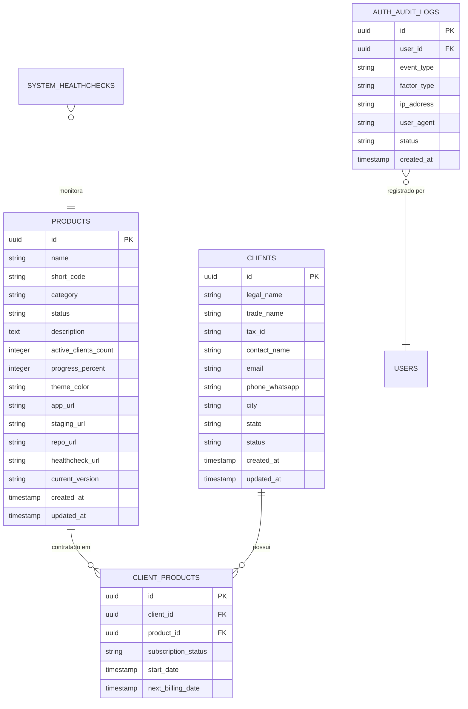

# Dicionário de Dados e Modelagem de Persistência - Ecossistema SalusDev

- **Documento:** Modelagem Conceitual, Lógica e Dicionário de Dados
- **Versão:** 1.0
- **Data:** 2026-11-06
- **Agente:** `@data-engineer` (Dara)
- **Status:** Homologado
- **Referências:** [PRD-SalusDev-v0.3.md](file:///D:/SalusDev%20-%20Admin/docs/produto/PRD-SalusDev-v0.3.md) (v0.4), [RegrasSystema.md](file:///D:/SalusDev%20-%20Admin/docs/produto/RegrasSystema.md) (v1.4) e [ARCHITECTURE.md](file:///D:/SalusDev%20-%20Admin/docs/arquitetura/ARCHITECTURE.md)

---

## 1. Visão Geral da Modelagem de Dados

A arquitetura de dados do ecossistema SalusDev segue os princípios de **privilégio mínimo**, **isolamento estrito de responsabilidades** e **privacidade desde a concepção (Privacy by Design)**, com suporte a bancos PostgreSQL gerenciados via Supabase.

A persistência é dividida em duas camadas fundamentais:
1. **Camada Corporativa SalusDev (Banco Central do Admin):** Centraliza o Catálogo de Produtos, Metadados de Sistemas, Cadastro de Clientes e Logs de Auditoria do Centro de Comando.
2. **Camada de Produtos Satélites (Bancos Isolados por Solução SaaS):** Cada produto SaaS comercializado (como o Salus Oficina) opera com seu próprio banco de dados isolado, garantindo conformidade absoluta com a LGPD e evitando contaminação de dados multi-tenant.

---

## 2. Entidades do Catálogo Central (Centro de Comando)

### 2.1 Tabela `products` (Catálogo Canônico de Aplicações)

Representa a fonte oficial da verdade sobre qualquer produto ou aplicação mantida no ecossistema SalusDev.

| Coluna | Tipo de Dado | Nulo? | Restrições | Descrição Semântica |
|---|---|---|---|---|
| `id` | `UUID` | Não | Chave Primária (`gen_random_uuid()`) | Identificador universal único do produto |
| `slug` | `VARCHAR(64)` | Não | Único (`UNIQUE`) | Identificador amigável de rota (ex.: `salus-oficina`) |
| `name` | `VARCHAR(128)` | Não | Não vazio | Nome comercial completo da aplicação |
| `short_code` | `VARCHAR(4)` | Não | 2 a 4 caracteres | Sigla abreviada para exibição em badges (ex.: `SO`, `SD`) |
| `category` | `VARCHAR(64)` | Não | Padrão: 'Outros' | Categoria funcional (ex.: 'SaaS', 'Site Institucional') |
| `status` | `VARCHAR(32)` | Não | Check Enum | 'Planejamento', 'Desenvolvimento', 'Piloto', 'Ativo', 'Descontinuado' |
| `description` | `TEXT` | Não | - | Resumo executivo da proposta do produto |
| `active_clients_count` | `INTEGER` | Não | Padrão: 0, `>= 0` | Contagem total agregada de clientes ativos no produto |
| `progress_percent` | `INTEGER` | Não | Entre 0 e 100 | Percentual de conclusão da versão em andamento |
| `theme_color` | `VARCHAR(7)` | Não | Hex (`^#[0-9A-Fa-f]{6}$`) | Cor tema de identificação visual no formato hexadecimal |
| `app_url` | `VARCHAR(255)` | Sim | Formato URL HTTPS | Endereço oficial em ambiente de produção |
| `staging_url` | `VARCHAR(255)` | Sim | Formato URL HTTPS | Endereço do ambiente de homologação |
| `repo_url` | `VARCHAR(255)` | Sim | Formato URL GitHub | Link para o repositório de código fonte |
| `healthcheck_url` | `VARCHAR(255)` | Sim | Formato URL HTTPS | Endpoint de verificação de integridade e latência |
| `current_version` | `VARCHAR(16)` | Não | SemVer (ex.: `v1.0.0`) | Versão de compilação atualmente ativa |
| `created_at` | `TIMESTAMPTZ` | Não | Padrão: `NOW()` | Data e hora de criação do registro |
| `updated_at` | `TIMESTAMPTZ` | Não | Padrão: `NOW()` | Data e hora da última modificação |

### 2.2 Tabela `clients` (Cadastro de Clientes do Ecossistema)

Armazena os dados cadastrais das empresas atendidas pela SalusDev.

| Coluna | Tipo de Dado | Nulo? | Restrições | Descrição Semântica |
|---|---|---|---|---|
| `id` | `UUID` | Não | Chave Primária | Identificador único do cliente |
| `legal_name` | `VARCHAR(255)` | Sim | - | Razão Social completa da empresa |
| `trade_name` | `VARCHAR(255)` | Não | Não vazio | Nome Fantasia ou como o cliente é conhecido |
| `tax_id` | `VARCHAR(18)` | Sim | Formato CNPJ ou CPF | Documento fiscal do cliente (com máscara de validação) |
| `contact_name` | `VARCHAR(128)` | Não | Não vazio | Nome do responsável ou interlocutor principal |
| `email` | `VARCHAR(255)` | Sim | Formato de E-mail | E-mail para contato e envio de avisos |
| `phone_whatsapp` | `VARCHAR(20)` | Não | E.164 (`+5543...`) | Telefone celular com WhatsApp para atendimento direto |
| `city` | `VARCHAR(128)` | Não | Padrão: 'Apucarana' | Cidade onde a empresa está localizada |
| `state` | `VARCHAR(2)` | Não | Padrão: 'PR' | Unidade Federativa com duas letras |
| `status` | `VARCHAR(32)` | Não | Check Enum | 'Prospecção', 'Piloto', 'Ativo', 'Inativo' |
| `created_at` | `TIMESTAMPTZ` | Não | Padrão: `NOW()` | Data de início de relacionamento |
| `updated_at` | `TIMESTAMPTZ` | Não | Padrão: `NOW()` | Data de atualização cadastral |

### 2.3 Tabela `client_products` (Associações de Produtos por Cliente)

Tabela associativa que relaciona quais produtos do catálogo cada cliente contratou ou está utilizando.

| Coluna | Tipo de Dado | Nulo? | Restrições | Descrição Semântica |
|---|---|---|---|---|
| `id` | `UUID` | Não | Chave Primária | Identificador único da contratação |
| `client_id` | `UUID` | Não | Chave Estrangeira (`clients.id`) | Vínculo com a empresa contratante |
| `product_id` | `UUID` | Não | Chave Estrangeira (`products.id`) | Vínculo com o produto contratado |
| `subscription_status` | `VARCHAR(32)` | Não | Check Enum | 'Ativo', 'Degustação', 'Cancelado', 'Bloqueado' |
| `start_date` | `DATE` | Não | - | Data de início do serviço |
| `next_billing_date` | `DATE` | Sim | - | Próxima data de vencimento/renovação |

---

## 3. Segurança, Auditoria e Conformidade com MFA / 2FA (`AUTH-15`)

### 3.1 Tabela `auth_audit_logs` (Registro de Eventos de Autenticação)

Em conformidade estrita com a regra `AUTH-02` e `AUTH-15` de `RegrasSystema.md`, todo evento crítico de segurança é auditado de forma imutável:

| Coluna | Tipo de Dado | Nulo? | Restrições | Descrição Semântica |
|---|---|---|---|---|
| `id` | `UUID` | Não | Chave Primária | Identificador único do evento de auditoria |
| `user_id` | `UUID` | Sim | FK (`auth.users.id`) | Usuário que executou ou sofreu a ação |
| `event_type` | `VARCHAR(64)` | Não | - | 'LOGIN_PASSWORD_SUCCESS', 'MFA_CHALLENGE_SUCCESS', 'MFA_FAILED', 'LOGOUT', 'PASSWORD_RESET' |
| `factor_type` | `VARCHAR(32)` | Sim | - | 'totp' (App Autenticador), 'none' |
| `status` | `VARCHAR(16)` | Não | 'SUCCESS', 'FAILED' | Resultado da operação |
| `ip_address` | `INET` | Não | - | Endereço IP de origem da requisição |
| `user_agent` | `TEXT` | Não | - | Identificação do navegador e sistema operacional |
| `failure_reason` | `VARCHAR(128)` | Sim | - | Motivo de falha caso tenha ocorrido (sem vazar dados) |
| `created_at` | `TIMESTAMPTZ` | Não | Padrão: `NOW()` | Data e hora exatas do evento em UTC |

---

## 4. Diretrizes de Isolamento de Banco de Dados para SaaS Satélites

Para produtos como o `salus-oficina`, são aplicadas as seguintes diretrizes de arquitetura de dados:

1. **Separação Fisiológica de Bancos:** Os bancos operacionais das oficinas mecânicas nunca compartilham tabelas operacionais com o Centro de Comando da SalusDev.
2. **Obrigatoriedade de `tenant_id` (`ACL-06`):** Toda tabela operacional em bancos multi-tenant possui a coluna `tenant_id UUID NOT NULL` indexada.
3. **Políticas de RLS (Row Level Security):** Todas as tabelas operacionais possuem políticas RLS ativadas, garantindo que um cliente só possa consultar e modificar registros associados ao seu próprio `tenant_id`.
4. **Sem Chaves `service_role` no Frontend (`ACL-08`):** Toda operação no navegador utiliza exclusivamente a chave anônima pública (`anon-key`) com contexto de segurança autenticado.
