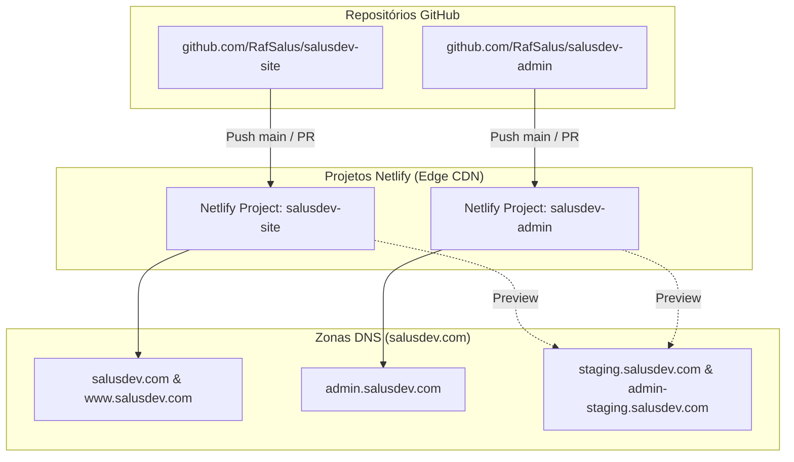
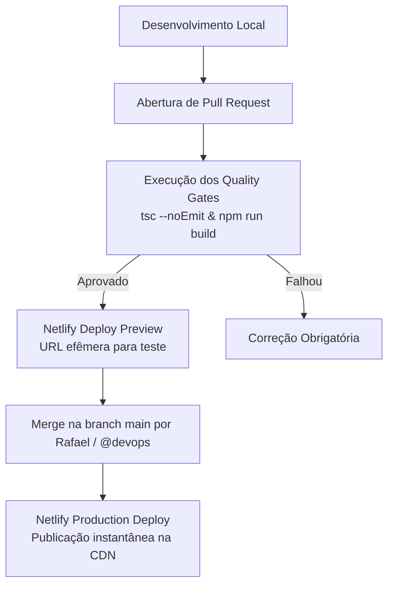

# Guia de Infraestrutura, Ambientes e Deploy - Ecossistema SalusDev

- **Documento:** Manual Técnico de Deploy, CI/CD e Configuração de Borda
- **Versão:** 1.0
- **Data:** 2026-11-06
- **Agente:** `@devops` (Gage)
- **Status:** Homologado
- **Referências:** [PRD-SalusDev-v0.3.md](file:///D:/SalusDev%20-%20Admin/doc/produto/PRD-SalusDev-v0.3.md) (v0.4), [RegrasSystema.md](file:///D:/SalusDev%20-%20Admin/doc/produto/RegrasSystema.md) (v1.4) e [ARCHITECTURE.md](file:///D:/SalusDev%20-%20Admin/docs/arquitetura/ARCHITECTURE.md)

---

## 1. Visão Geral da Infraestrutura

O ecossistema SalusDev é hospedado na infraestrutura de borda (*Edge CDN*) da **Netlify**, garantindo alta velocidade de carregamento, compressão moderna (Brotli/Gzip), certificados SSL/TLS automáticos e suporte nativo a Single Page Applications (SPA) e PWA.

Seguindo a diretriz de **Multi-Repo**, cada aplicação possui seu próprio projeto de hospedagem independente no Netlify:



---

## 2. Topologia de Domínios e Roteamento DNS

| Domínio / Subdomínio | Aplicação Vinculada | Tipo de Ambiente | SSL/TLS |
|---|---|---|---|
| `salusdev.com` | `salusdev-site` | Produção (Vitrine pública) | Let's Encrypt (Automático) |
| `www.salusdev.com` | `salusdev-site` | Redirecionamento 301 para `salusdev.com` | Let's Encrypt (Automático) |
| `admin.salusdev.com` | `salusdev-admin` | Produção (Centro de Comando) | Let's Encrypt (Automático) |
| `staging.salusdev.com` | `salusdev-site` | Homologação e testes pré-release | Let's Encrypt (Automático) |
| `admin-staging.salusdev.com` | `salusdev-admin` | Homologação administrativa | Let's Encrypt (Automático) |

---

## 3. Especificação do Arquivo de Configuração (`netlify.toml`)

Cada repositório deve incluir seu respectivo `netlify.toml` na raiz, configurando comandos de compilação, redirecionamento SPA e cabeçalhos de segurança obrigatórios (`CFG-02`):

```toml
[build]
  command = "npm run build"
  publish = "dist"

# Redirecionamento para Single Page Application (SPA)
[[redirects]]
  from = "/*"
  to = "/index.html"
  status = 200

# Cabeçalhos de Segurança Obrigatórios (OWASP Top 10 e Regras do Sistema)
[[headers]]
  for = "/*"
  [headers.values]
    X-Frame-Options = "DENY"
    X-Content-Type-Options = "nosniff"
    Referrer-Policy = "strict-origin-when-cross-origin"
    Permissions-Policy = "camera=(), microphone=(), geolocation=(), payment=()"
    Strict-Transport-Security = "max-age=31536000; includeSubDomains; preload"
    Content-Security-Policy = "default-src 'self'; script-src 'self' 'unsafe-inline'; style-src 'self' 'unsafe-inline' https://fonts.googleapis.com; font-src 'self' https://fonts.gstatic.com; img-src 'self' data: https:; connect-src 'self' https://*.supabase.co;"

# Cache longo e imutável para assets estáticos com hash
[[headers]]
  for = "/assets/*"
  [headers.values]
    Cache-Control = "public, max-age=31536000, immutable"

# Cache seguro para o Service Worker (sempre revalidar)
[[headers]]
  for = "/sw.js"
  [headers.values]
    Cache-Control = "public, max-age=0, must-revalidate"
```

---

## 4. Gestão de Variáveis de Ambiente e Segredos

Em conformidade com a regra `SEC-04` e `ACL-08`:

1. **Nenhum arquivo `.env` com segredos reais deve ser commitado no Git.**
2. O arquivo `.gitignore` deve incluir obrigatoriamente:
   ```text
   .env
   .env.local
   .env.production
   ```
3. As variáveis são configuradas diretamente no painel da Netlify (Site Configuration > Environment Variables):
   - `VITE_SUPABASE_URL`: URL da instância Supabase (pública);
   - `VITE_SUPABASE_ANON_KEY`: Chave anônima para requisições no navegador (pública com RLS ativo);
   - `SUPABASE_SERVICE_ROLE_KEY`: **Proibida no frontend** (usada apenas em Edge Functions serverless, se aplicável).

---

## 5. Pipeline de CI/CD e Quality Gates Automatizados

O fluxo de publicação segue uma esteira protegida:



### 5.1 Regras de Branches

- `main`: Branch de produção estável. Apenas merges autorizados pelo `@devops` e aprovados por Rafael Amaral Salustiano.
- `feat/*` ou `fix/*`: Branches de trabalho para implementação de planos ou correções de bugs.

---

## 6. Procedimento de Rollback de Emergência

Caso um deploy apresente instabilidade ou comportamento inesperado em produção:

1. Acessar o painel do projeto no Netlify (Deploys).
2. Localizar o último deploy funcional com status "Published".
3. Clicar em "Publish deploy" para restaurar a versão estável em menos de 5 segundos.
4. Notificar a equipe, registrar o incidente em `docs/bugs/` e iniciar a triagem de causa raiz.
