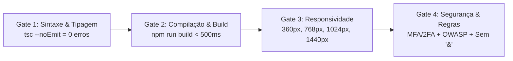

# Plano de Qualidade e Testes - Ecossistema SalusDev

- **Documento:** Estratégia de Testes, Quality Gates e Matriz de Validação
- **Versão:** 1.0
- **Data:** 2026-11-06
- **Agente:** `@qa` (Quinn)
- **Status:** Homologado
- **Referências:** [RegrasSystema.md](file:///D:/SalusDev%20-%20Admin/docs/produto/RegrasSystema.md) (v1.4) e [RegrasDesenvolvimento.md](file:///D:/SalusDev%20-%20Admin/docs/produto/RegrasDesenvolvimento.md)

---

## 1. Estratégia de Qualidade e Visão Geral

A garantia da qualidade no ecossistema SalusDev é orientada pela rastreabilidade de requisitos, verificação contínua e tolerância zero para falhas de segurança e de responsividade.

Toda entrega, tela ou funcionalidade deve passar por validações automatizadas e manuais antes de ser homologada, respeitando a separação obrigatória entre testes em **Desktop `[D]`** e **Mobile `[M]`**.

---

## 2. Quality Gates de Entrega

Para que uma alteração seja considerada aprovada pela equipe de QA, os seguintes Quality Gates devem ser satisfeitos:

| Quality Gate | Critério de Aceite | Ferramenta / Comando | Bloqueante? |
|---|---|---|---|
| **Gate 1: Tipagem Estrita** | Zero erros de compilação TypeScript | `npx tsc --noEmit` | Sim |
| **Gate 2: Compilação de Produção** | Build sem warnings críticos, gerando bundles otimizados | `npm run build` | Sim |
| **Gate 3: Matriz de Viewports** | Sem rolagem horizontal e alvos de toque >= 44px | Inspeção Chrome DevTools nos 4 viewports | Sim |
| **Gate 4: Segurança e MFA** | Validação de duplo fator (TOTP) e sessão segura | Teste de fluxo de login | Sim |
| **Gate 5: Texto e Gramática** | Português correto, acentuado e sem o caractere `&` | Validação visual de cópia | Sim |

---

## 3. Matriz de Testes de Viewports (Conformidade `GER-03` e `R11`)

| Viewport | Perfil | Parâmetros de Teste | Checklist Obrigatório |
|---|---|---|---|
| **360 px** | Mobile Pequeno `[M]` | Resolução 360 x 800, DPR 3.0, touch emulado | - [ ] Sem scroll horizontal (`GER-04`) - [ ] Sidebar recolhida em Drawer funcional - [ ] Alvos de toque >= 44 x 44 px - [ ] Teclado numérico no campo OTP |
| **768 px** | Tablet Vertical | Resolução 768 x 1024, DPR 2.0 | - [ ] Transição fluida entre drawer e menu lateral - [ ] Grids ajustados para 2 colunas - [ ] Imagens e cartões sem distorção |
| **1024 px** | Notebook / Desktop `[D]` | Resolução 1024 x 768, DPR 1.0 | - [ ] Sidebar visível ou compacta com ícones - [ ] Tabelas legíveis com paginação - [ ] Modais centralizados sem corte |
| **1440 px** | Desktop Padrão `[D]` | Resolução 1440 x 900, DPR 1.0 | - [ ] Painel analítico completo em 4 colunas - [ ] Navegação completa por teclado com foco visível - [ ] Espaçamento simétrico e sem esticamentos |

---

## 4. Plano de Testes PWA (Progressive Web App)

1. **Manifesto (`manifest.json`):**
   - Validar se o manifest é servido com `Content-Type: application/manifest+json`.
   - Verificar presença das propriedades `name`, `short_name`, `start_url`, `display: standalone`, `theme_color` e ícones `192x192` e `512x512`.
2. **Service Worker e Cache (`PWAS-01`):**
   - Verificar no DevTools (Application > Service Workers) se o registro ocorre sem falhas.
   - Garantir que apenas assets públicos (HTML, JS, CSS, fontes e imagens) estejam no cache do navegador.
   - **Teste de Vazamento:** Verificar se requisições para APIs privadas ou com dados de clientes retornam status de rede direta e não são salvas no cache de armazenamento.
3. **Instalação (A2HS):**
   - Testar o prompt de instalação no Android (Chrome) e validar o comportamento no Safari iOS (adicionar à tela de início).

---

## 5. Plano de Testes de Autenticação e MFA / 2FA (`AUTH-02`)

1. **Tentativa de Acesso com Fator Único:**
   - Inserir credenciais válidas e verificar se a sessão permanece em estado restrito (AAL1) sem liberar as rotas privadas.
2. **Desafio de Segundo Fator (TOTP):**
   - Digitar código de 6 dígitos gerado pelo aplicativo autenticador.
   - Validar se o código expirado ou inválido retorna mensagem amigável e segura ("Código de verificação incorreto") sem vazar detalhes técnicos.
   - Validar avanço automático após digitação do sexto dígito.
3. **Persistência de Sessão Segura (`AUTH-05`):**
   - Inspecionar `localStorage` e `sessionStorage` e certificar-se de que nenhum token JWT de acesso privilegiado esteja gravado lá.

---

## 6. Procedimento de Registro e Gestão de Bugs

Caso qualquer divergência seja identificada durante as rodadas de testes:

1. O avaliador deve abrir um arquivo formal em `docs/bugs/` utilizando o modelo `docs/bugs/templates/bug-template.md`.
2. Nomear o arquivo como `BUG-XXXX-descricao-curta.md`.
3. Registrar o bug no índice geral `docs/bugs/INDEX.md` com status "Aberto".
4. Acionar o `@dev` para correção com isolamento estrito de escopo.
5. Após a correção, reexecutar a matriz de testes para certificar ausência de regressão antes de fechar o apontamento.
